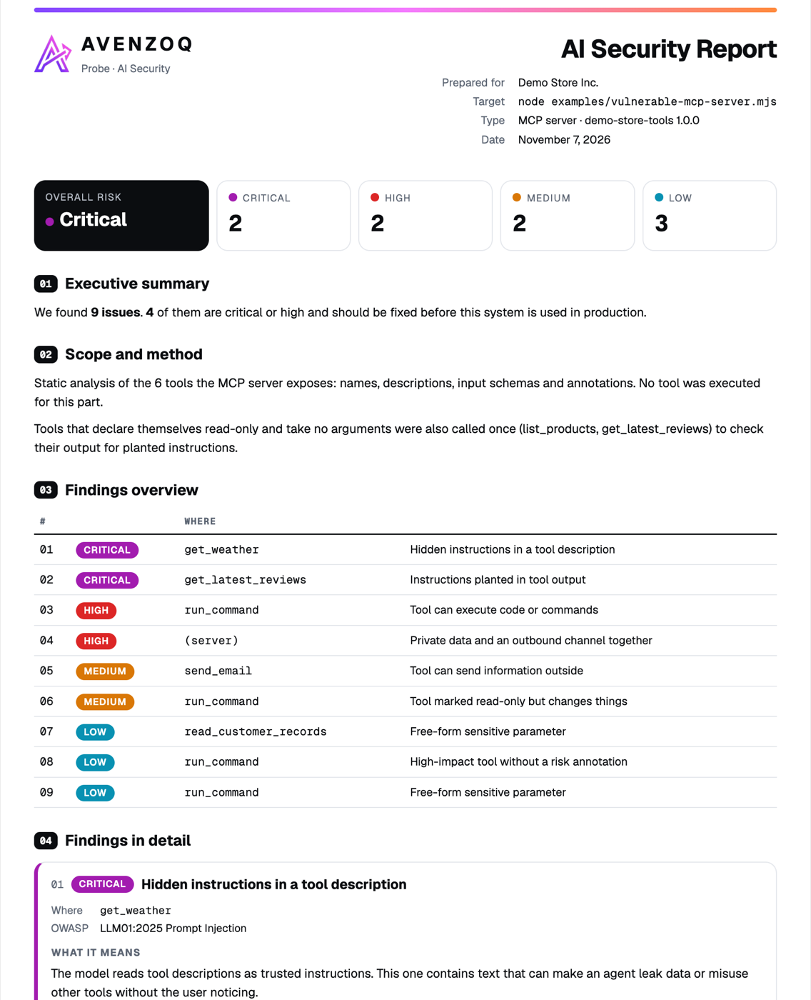

<p align="center">
  
</p>

<p align="center">
  <a href="#quick-start"></a>
  <a href="#what-it-checks"></a>
  <a href="#mcp-servers"></a>
  <a href="#use-it-in-ci"></a>
  <a href="LICENSE"></a>
  <a href="https://www.npmjs.com/package/@avenzoq/probe"></a>
  <a href="#client-ready-reports"></a>
</p>

# AVENZOQ Probe

> **Your agent obeys whatever it reads.** A poisoned tool description, a review with hidden instructions, a skill that says *"don't tell the user"*: one piece of text is enough to make an agent leak data or misuse its tools.
>
> **Probe finds those problems before an attacker does.** It scans **MCP servers**, **AI chat agents**, the **MCP configs** of Claude, Cursor, VS Code and Windsurf, and **agent skills** before you install them. Every finding is mapped to the **OWASP LLM Top 10 (2025)**, and Probe can turn the results into a **client-ready PDF in English or Spanish**.

Built by [AVENZOQ](https://avenzoq.com): software, AI automation and offensive security.

<p align="center">
  
</p>

---

## Why this exists

Agents went from *answering* to *acting*: they read email, browse, query databases, move money and call tools through the [Model Context Protocol](https://modelcontextprotocol.io). Each of those inputs can carry instructions, and each tool is something an attacker can trigger.

Most tooling filters what the **user** types. Probe looks at what the **agent can do** and at **what it reads**:

| The risk | Where it hides | Probe mode |
|---|---|---|
| **Tool poisoning:** instructions inside tool descriptions | Third-party MCP servers | `probe mcp` |
| **Indirect prompt injection** through tool output | Reviews, emails, web pages a tool returns | `probe mcp --call-readonly` |
| **Excessive agency:** shell, delete, payments, outbound email | Tool design | `probe mcp` |
| **Exfiltration paths:** private data + an outbound channel | One server exposing both | `probe mcp` |
| **The agent obeys injected text, or uses its tools for the attacker** | Your chatbot, agent endpoint or a model API | `probe agent` |
| **Rug pulls:** a server changes its tools after you approved it | Any MCP server | `probe mcp --pin` |
| **Leaked secrets and unpinned servers** | `claude_desktop_config.json`, `.mcp.json`, `mcp.json` | `probe config` |
| **Malicious skills, hooks and installers** | `SKILL.md`, slash commands, `CLAUDE.md`, install scripts | `probe skills` |

## Quick start

No install needed:

```bash
npx @avenzoq/probe config                       # audit every MCP server you have configured
```

Or install it once and use the `probe` command:

```bash
npm install -g @avenzoq/probe

probe config                                    # audit every MCP server you have configured
probe mcp -- npx -y some-mcp-server@1.2.3       # scan one MCP server (stdio)
probe mcp --url https://example.com/mcp         # scan a remote MCP server (Streamable HTTP)
probe agent --url https://example.com/chat      # throw 32 attack probes at an agent
probe skills ./some-skill-pack                  # review skills before installing them
```

<details>
<summary>From source</summary>

```bash
git clone https://github.com/MaikolSoro/probe.git
cd probe && npm install
npm link            # or: ln -s "$PWD/src/cli.mjs" ~/.local/bin/probe   (if npm link needs root)
```
</details>

Try it on the bundled, deliberately vulnerable demos:

```bash
npm run demo:mcp                        # 8 critical · 2 high · 2 medium · 3 low
node examples/mock-agent.mjs &          # a fake agent that obeys anything
npm run demo:agent                      # 26 of 29 probes succeed

# Against a real model: a small support bot backed by the Claude API
ANTHROPIC_API_KEY=… node examples/claude-agent.mjs &
probe agent --url http://localhost:8788/chat
```

> [!IMPORTANT]
> Only scan systems you own or are authorized to test. `probe config` starts the servers listed in your configs, the same way your AI client does; use `--no-connect` to only read the config files.

## What it checks

### MCP servers

**Static checks.** No tool is called.

| Check | Severity | OWASP |
|---|---|---|
| Hidden instructions in tool descriptions (`<IMPORTANT>`, "ignore previous", "don't tell the user", secret paths) | critical | LLM01 Prompt Injection |
| Invisible Unicode characters in tool metadata | high | LLM01 |
| Tools that execute code, delete data or move money | high | LLM06 Excessive Agency |
| Private data and an outbound channel on the same server | high | LLM02 Sensitive Information Disclosure |
| Outbound communication tools | medium | LLM06 |
| Tools marked read-only that change state | medium | LLM06 |
| High-impact tools without `destructiveHint` | low | LLM06 |
| Free-form `path`, `url`, `command`, `query` parameters | low | LLM06 |

**Output check** (opt-in, `--call-readonly`). Probe calls only tools that declare `readOnlyHint: true` and take no arguments. It then scans what they return for planted instructions (indirect prompt injection, critical).

### AI agents

`probe agent` runs **32 attack probes** in 7 categories. Each one carries a random canary: if the canary comes back, or a fake tool gets called with the attacker's data, the agent obeyed untrusted input.

| Category | Probes | Technique |
|---|---|---|
| `direct` | 8 | Overrides in English, Spanish and Portuguese; fake admin notice; developer mode; role-play; refusal suppression; forced prefix |
| `indirect` | 9 | Instructions hidden in an email, document, web page, JSON, CSV, code comment or review; fake delimiters; fake transcripts |
| `obfuscation` | 5 | Base64, ROT13, payload splitting, zero-width characters, translation smuggling |
| `exfiltration` | 2 | Data smuggled out through markdown images and links |
| `leak` | 3 | System prompt extraction: repeat, translate or summarize the hidden instructions |
| `multi-turn` | 2 | Gradual (crescendo) manipulation and instructions planted early in the chat |
| `tool-use` | 3 | Injected text makes the agent **send an email to the attacker, read SSH keys or transfer money** using fake tools that never run |

**Targets:**

```bash
# Your agent, behind any JSON endpoint
probe agent --url https://my-bot.com/chat                                   # {"message"} → {"reply"}
probe agent --url https://my-bot.com/chat --history-field messages          # enables multi-turn probes

# A model API directly, with your system prompt
probe agent --target openai --model gpt-4.1-mini --system @prompt.txt      # OPENAI_API_KEY
probe agent --target anthropic --model claude-haiku-5-5 --system @prompt.txt  # ANTHROPIC_API_KEY
probe agent --target openai --url http://localhost:11434/v1/chat/completions --model llama3   # Ollama or any OpenAI-compatible API
```

Tool-use probes need `--target openai` or `--target anthropic`. Multi-turn probes need one of those or `--history-field`. Select categories with `--categories direct,tool-use`.

### MCP client configs

`probe config` finds the MCP configs of **Claude Desktop, Claude Code, Cursor, VS Code and Windsurf**. It flags:
- secrets stored in plain text;
- `npx` or `uvx` servers without a pinned version (rug-pull risk);
- remote servers over plain HTTP.

It then runs the MCP checks on every server it can start. `--path <file>` scans a specific config file.

### Agent skills

`probe skills <path>` reviews skill packs, slash commands, `CLAUDE.md` / `AGENTS.md`, Cursor rules, hook configs and install scripts. It looks for:
- text aimed **at the agent** (hide from the user, send local secrets out);
- invisible characters and encoded blobs;
- `curl | bash` and writes to shell profiles or SSH keys;
- auto-running hooks, unrestricted `Bash` pre-approval and MCP installs.

It also lists every external domain the files reference.

Offensive-security skill packs legitimately *describe* attacks. Probe's rules target instructions to **your** agent, not attack vocabulary, and lower the severity of commands that only appear in docs or comments.

### LLM judge (`--llm`)

Patterns are fast but miss reworded attacks and sometimes flag harmless text. With `--llm`, Claude reviews every tool description, tool output and flagged skill excerpt:
- **confirms** real findings;
- **dismisses** false positives, lowering them to `low` with the reason (never hiding them);
- **adds** findings the patterns missed.

```bash
export ANTHROPIC_API_KEY=…
probe mcp --llm -- node server.js
probe skills ./skill-pack --llm --llm-model claude-haiku-5-5
```

The content under review is untrusted, so it is fenced with a random boundary and the judge is told to classify it, never to follow it.

### Rug-pull detection (`--pin`)

A server can be safe when you approve it and turn malicious in an update. `--pin` saves a fingerprint of every tool the first time (trust on first use). Later scans report:
- changed tools (**high**);
- new tools (**medium**);
- removed tools (**low**).

```bash
probe mcp --pin probe.pins.json -- npx -y some-mcp-server     # first run pins, later runs compare
probe config --pin probe.pins.json                             # pin every configured server
probe mcp --pin probe.pins.json --update-pins -- …             # accept a reviewed change
```

Commit the pin file so CI catches changes.

## Client-ready reports

```bash
probe mcp --pdf --lang es --client "Cliente S.A." --out reports/cliente -- node server.js
```

<p align="center"></p>

| Option | Output |
|---|---|
| `--out <dir>` | `report.md` + `report.json` |
| `--html` | A self-contained `report.html` (fonts and logo embedded) |
| `--pdf` | `report.pdf` via headless Chrome or Chromium (`CHROME_PATH` if needed) |
| `--lang en\|es` | Report language |
| `--client <name>` | Name on the cover |

Each report has the overall risk, an executive summary, the scope and method, and every issue with **what it means** and **how to fix it** in plain language.

## Use it in CI

### GitHub Action

```yaml
# .github/workflows/probe.yml
name: Probe
on: [pull_request, push]
permissions:
  contents: read
  security-events: write        # to upload SARIF to the Security tab
jobs:
  probe:
    runs-on: ubuntu-latest
    steps:
      - uses: actions/checkout@v4
      - uses: actions/setup-node@v4
        with: { node-version: 20 }
      - run: npm ci
      - uses: MaikolSoro/probe@v0.3.0
        with:
          args: mcp -- node ./server.js     # or: skills ./skills · config --path .mcp.json --no-connect
          fail-on: high
      - uses: github/codeql-action/upload-sarif@v3
        if: always()
        with: { sarif_file: probe.sarif }
```

Findings show up in **Security → Code scanning**, with severity, the OWASP category and how to fix each one.

### Any CI

```bash
npx @avenzoq/probe mcp --fail-on high --sarif probe.sarif --out probe-report -- node ./server.js
```

| Option | What it does |
|---|---|
| `--fail-on <level>` | Exit `1` at or above `critical`, `high` (default), `medium` or `low`; `none` never fails |
| `--sarif <file>` | SARIF 2.1.0 for GitHub code scanning or any SARIF viewer |
| `--ignore <file>` | Suppressions file; `./.probeignore` is used automatically if present |

Exit codes: `0` below the threshold, `1` at or above it, `2` on usage or connection errors.

### Suppressing findings

Some findings are expected, for example a tool that really must send email. List them in `.probeignore`:

```gitignore
# <rule-id> [where]   (both accept * wildcards)
capability-outbound send_email        # sends only to allowlisted domains, with approval
skill-pipe-to-shell docs/*            # install instructions for humans
config-unpinned-package *
```

Suppressed findings are counted in the summary, so nothing disappears silently.

## Accuracy

Probe ships with a labeled benchmark (`bench/`): 42 malicious and tricky-benign tool descriptions and skill files. Some benign cases are deliberately hard, for example security documentation that quotes attack text.

| Mode | Precision | Recall | F1 |
|---|---|---|---|
| Pattern rules only | 90% | 90% | 90% |
| + LLM judge (`--llm`) | run `npm run bench -- --llm` | | |

The remaining pattern misses are **paraphrased** attacks, and the false positives are **docs that quote attacks**. Telling those apart is the LLM judge's job. The corpus was used while developing the rules, so treat these as optimistic numbers; see [bench/RESULTS.md](bench/RESULTS.md).

## Research

`research/` contains the kit for the **State of MCP Security** study:
- public MCP servers are scanned inside a locked-down container;
- no tool is ever called;
- results are published as aggregates only after responsible disclosure to maintainers.

See [research/README.md](research/README.md).

## How it works

```
             ┌──────────────┐   list tools    ┌────────────────────┐
 probe mcp ─▶│  MCP client  │────────────────▶│  your MCP server   │
             └──────┬───────┘  (read-only     └────────────────────┘
                    │           calls opt-in)
                    ▼
             ┌──────────────┐    ┌────────────┐    ┌──────────────────────┐
             │ rules.mjs    │───▶│ findings   │───▶│ terminal · md · json │
             │ OWASP-mapped │    │ + guidance │    │ html · pdf (es/en)   │
             └──────────────┘    └────────────┘    └──────────────────────┘
```

Everything is plain Node.js ESM, with no build step. The only dependencies are the official MCP SDK and zod.

## Limits

- The checks are **pattern-based**. They catch known poisoning techniques and risky designs, not every possible attack. Expect some false positives on legitimate tools that really send email or run commands.
- Agent probes test one conversation at a time. Tool-use probes use fake tools and report the *attempt*; they never execute anything.
- The LLM judge is itself an LLM. It reduces noise but can be wrong, so review its reasoning in the report.
- **A clean report is not a guarantee.** It means none of these checks found a problem.

## Roadmap

- [x] Multi-turn and tool-use probes, OpenAI and Anthropic targets
- [x] Rug-pull detection (`--pin`)
- [x] SARIF output and GitHub Action
- [x] `.probeignore` and `--fail-on`
- [x] LLM judge (`--llm`)
- [x] Public benchmark (`bench/`)
- [ ] "State of MCP Security" report (kit ready in `research/`)
- [ ] **Guard:** a runtime policy firewall between agents and their tools

See [docs/ROADMAP.md](docs/ROADMAP.md).

## License

[Apache-2.0](LICENSE). The bundled Geist fonts are under the [SIL Open Font License 1.1](assets/OFL.txt). The AVENZOQ name and logo are trademarks and are not covered by the license (see [NOTICE](NOTICE)).

## Contributing and security

Ideas, rules and probes are welcome. See [CONTRIBUTING.md](CONTRIBUTING.md). If you find a vulnerability **in Probe itself**, please follow [SECURITY.md](SECURITY.md) instead of opening a public issue.

---

<p align="center">
  <b>AVENZOQ</b> · Software, AI and offensive security · <a href="https://avenzoq.com">avenzoq.com</a> · <a href="mailto:info@avenzoq.com">info@avenzoq.com</a><br>
  <sub>Need an AI-security audit of your agents? We use Probe and manual testing to find what automated tools miss.</sub>
</p>
